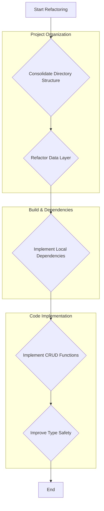

# Project Analysis Report

After a comprehensive analysis of the project, several key gaps and potential issues have been identified that could lead to build errors or maintenance challenges.

## 1. Project Structure and Organization

*   **Duplicated Directories:** The project contains duplicated directory structures, such as `pages/` and `src/pages/`, as well as `hooks/` and `src/hooks/`. This creates ambiguity and confusion, making it difficult to locate files and understand the project's architecture. It is a strong indicator of a disorganized codebase that needs immediate refactoring.

*   **Monolithic Data Layer:** The entire RxDB schema and database setup are defined in a single file, `services/rxdbService.ts`. This file is over 400 lines long and contains dozens of schema definitions. This monolithic approach makes the data layer difficult to navigate, maintain, and extend. Breaking it down into smaller, module-specific files would significantly improve its manageability.

## 2. Build and Dependency Management

*   **CDN-Based Imports:** The project relies on an `importmap` in `index.html` to load dependencies from a CDN (`esm.sh`). While this can simplify initial setup, it introduces several risks:
    *   **Versioning:** It can lead to unexpected behavior if the CDN serves updated package versions that are not compatible with the existing codebase.
    *   **Availability:** The application's ability to build and run is dependent on the availability and performance of the CDN.
    *   **Build Process:** This approach bypasses the standard `npm`/`yarn` dependency management and bundling process, which can make it harder to optimize the application and manage dependencies consistently.

## 3. Code Implementation and Completeness

*   **Unimplemented Functions:** A significant portion of the application's business logic is unimplemented. Both the `hooks/useRxDBData.ts` and `hooks/useMockData.ts` hooks contain a large number of placeholder functions that return `unimplementedAsync`. This means that while the data schemas are defined, the application lacks the functionality to create, read, update, or delete data.

*   **Type Safety Issues:** The use of `any` in several key places, particularly in `services/rxdbService.ts` and `hooks/useRxDBData.ts`, suppresses TypeScript's type-checking. This can hide potential bugs and make the code harder to refactor and maintain.

## Summary of Recommendations

Here is a summary of the recommended actions:

## Next Steps

The project has a solid foundation with a well-defined data schema, but it requires significant work to become a functional application. The most critical next steps are to refactor the project structure, implement the missing business logic, and address the dependency management strategy.