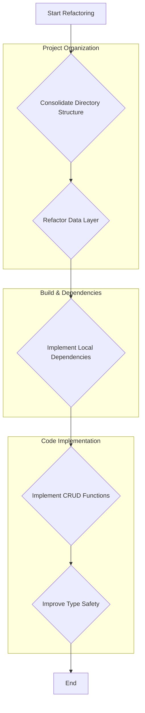

# Project Analysis Report

After a comprehensive analysis of the project, several key gaps and potential issues have been identified that could lead to build errors or maintenance challenges.

## 1. Project Structure and Organization

*   **Duplicated Directories:** The project contains duplicated directory structures, such as `pages/` and `src/pages/`, as well as `hooks/` and `src/hooks/`. This creates ambiguity and confusion, making it difficult to locate files and understand the project's architecture. It is a strong indicator of a disorganized codebase that needs immediate refactoring.

*   **Monolithic Data Layer:** The entire RxDB schema and database setup are defined in a single file, `services/rxdbService.ts`. This file is over 400 lines long and contains dozens of schema definitions. This monolithic approach makes the data layer difficult to navigate, maintain, and extend. Breaking it down into smaller, module-specific files would significantly improve its manageability.

## 2. Build and Dependency Management

*   **CDN-Based Imports:** The project relies on an `importmap` in `index.html` to load dependencies from a CDN (`esm.sh`). While this can simplify initial setup, it introduces several risks:
    *   **Versioning:** It can lead to unexpected behavior if the CDN serves updated package versions that are not compatible with the existing codebase.
    *   **Availability:** The application's ability to build and run is dependent on the availability and performance of the CDN.
    *   **Build Process:** This approach bypasses the standard `npm`/`yarn` dependency management and bundling process, which can make it harder to optimize the application and manage dependencies consistently.

## 3. Code Implementation and Completeness

*   **Unimplemented Functions:** A significant portion of the application's business logic is unimplemented. Both the `hooks/useRxDBData.ts` and `hooks/useMockData.ts` hooks contain a large number of placeholder functions that return `unimplementedAsync`. This means that while the data schemas are defined, the application lacks the functionality to create, read, update, or delete data.

*   **Type Safety Issues:** The use of `any` in several key places, particularly in `services/rxdbService.ts` and `hooks/useRxDBData.ts`, suppresses TypeScript's type-checking. This can hide potential bugs and make the code harder to refactor and maintain.

## Summary of Recommendations

Here is a summary of the recommended actions:

## Phase 2: Data Layer Refactoring

Following the initial analysis, a major refactoring of the application's data layer was undertaken to address the "Monolithic Data Layer" issue and to provide a complete, usable set of data for UI development.

### Key Achievements:

*   **Modular Mock Data:** The single, unmanageable `useMockData.ts` file was eliminated. All mock data has been logically separated into the modules it belongs to (e.g., `administration`, `academics`, `finance`). Each module now contains a `data/mockData.ts` file, making the data sources easy to find, manage, and extend.

*   **Data Composition Root:** A new data hook, `src/hooks/useCompleteMockData.ts`, now serves as a clean composition root. It imports all the modular data and assembles it into the complete `AppDataContextType` required by the application. This separates the concern of data storage from data provisioning.

*   **Complete Data Coverage:** All data entities defined in `src/core/types.ts` now have corresponding mock data, including previously overlooked entities like `Workflows`. This provides a rich and consistent dataset for building and testing UI components across the entire application.

*   **Centralized Type Safety:** The refactoring was performed with strict adherence to the central type definitions in `src/core/types.ts`, ensuring data consistency and type safety.

This refactoring has transformed the data layer from a significant liability into a well-organized, maintainable, and scalable asset.

## Next Steps

With a solid, modular data foundation now in place, the next logical steps involve building out the UI and state management to interact with this data. The application is now in a strong position for rapid feature development.