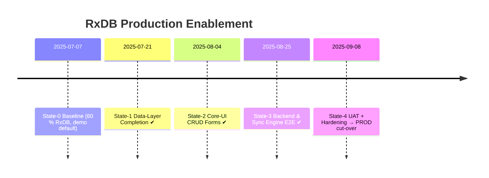

# RxDB Production-Mode Roll-out Workflow  
*SchoolPilot3 • Generated 07 Jul 2025 16:00*

---

## How to Use These Workflow Files
1. **Each file = One “state” snapshot**.  
   *State-0* = baseline, *State-1* = after first milestone, etc.  
2. **Always append** a new file after finishing a milestone:  
   `docs/workflows/rxdb_production_mode_workflow_<next-timestamp>.md`
3. Follow the **Done / Pending / Next** tables; update them honestly.
4. Keep the **file header & mermaid roadmap** pattern for continuity.

---

## Mermaid Roadmap (high-level)



---

# 📍 **STATE-0 — Baseline (this file)**

| Category | Status | Notes |
|----------|--------|-------|
| RxDB Core Service | **Done** | `rxdbService.ts` initialised, 60 % entity schemas seeded |
| Data Hooks | **Partially Done** | Many hooks still load mock data |
| CRUD Coverage | **~40 %** | Large gaps in write/update/delete |
| UI Forms | **Missing** | Admin/Finance/Academic forms incomplete |
| Sync Engine | **Sketched** | Architecture in docs, not wired |
| Prod Readiness | 🔴 **NOT ready** | Assessment report lines 13-22 |

### References
- [`production-readiness-assessment.md`](../production-readiness-assessment.md:13)
- [`advanced-database-handler-architecture.md`](../advanced-database-handler-architecture.md:114)

---

# 🚀 **STATE-1 — Data-Layer Completion (target ETA 21 Jul 2025)**

## Objectives
1. **Replace all mock hooks** with RxDB-backed hooks.
2. **Implement missing CRUD funcs** in `useRxDBData.ts`.
3. **Align schemas** with MySQL structure (IDs, naming, indexes).
4. **Reactive subscriptions** for every collection.
5. **Unit-test coverage ≥ 90 %** for data layer.

## Task Breakdown

| # | Task | Owner | Acceptance Criteria |
|---|------|-------|---------------------|
| 1 | Patch module hooks (`useStudentData`, `useInvoiceData`, …) | FE Dev A | All hooks import data from `useAppData` (RxDB) when `APP_MODE==='production'`. |
| 2 | Complete generic helpers (`addGeneric`, `updateGeneric`, `deleteGeneric`) | FE Dev B | CRUD ops succeed & throw typed errors; tests pass. |
| 3 | Update 60+ schemas for ID `string` + proper indexes | DB Dev C | `npm run typecheck` passes; IndexedDB & MySQL columns match. |
| 4 | Seed Dexie storage with existing mock data for local use | FE Dev B | `seedDatabaseWithMockData` verified via Cypress test. |
| 5 | Add Jest tests for each CRUD path | QA Eng D | ≥ 90 % coverage lines & branches within `src/hooks/useRxDBData.ts`. |

## Done / Pending / Next Table

| Done (at close of State-1) | Pending | Next (State-2 trigger) |
|----------------------------|---------|------------------------|
| All hooks RxDB-powered | UI forms still stubbed | Begin Core-UI CRUD form build-out |
| CRUD helpers complete | Sync engine only stubbed | Connect forms to new hooks |
| Schemas aligned & migrated | Backend APIs still mocked | Prepare backend endpoints |

---

# 🔜 **STATE-2 — Core-UI CRUD Implementation**

*(placeholder, will be expanded in next file)*

| Goal | Description |
|------|-------------|
| Student & Staff admin forms | Admission, promotion, staff hiring |
| Finance forms | Invoice generation, payments |
| Academic forms | Exam session, grade entry |

---

# 🛠️ Template for Future State Files

```md
# STATE-X — <Milestone Title>

## Objectives
- …

## Task Breakdown
| # | Task | Owner | Criteria |

## Done / Pending / Next Table
| Done | Pending | Next |

## Notes / Decisions
- …
```

---

**Author:** AI Dev Assistant  
**Next File To Create After Finishing State-1:**  
`docs/workflows/rxdb_production_mode_workflow_<state-1-complete-timestamp>.md`